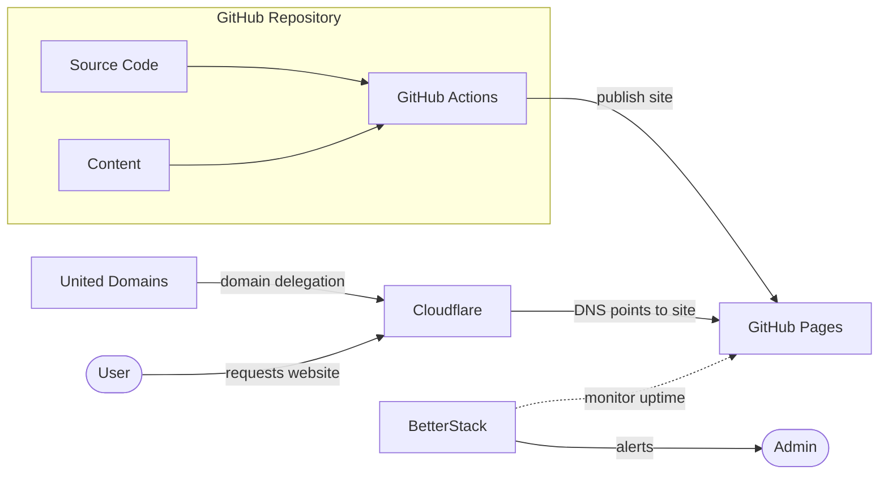

# Garbereder.com

[](https://github.com/ggarbereder/garbereder.com/actions/workflows/static.yml)
[](https://uptime.betterstack.com/?utm_source=status_badge)

## Architecture



## Prerequisites

- Node.js (LTS version recommended)
- VS Code (optional)

## Development

### Local Development

```bash
# Install dependencies
npm install

# Update browserslist database
npx browserslist@latest --update-db

# Start development server
npm run dev
```

### Build

The compiled page is published into the `dist` directory:

```bash
npm run build
```

### Testing

#### Run Unit Tests

```bash
npm run test
```

#### Run E2E Tests (Cypress)

```bash
# Run tests in headless mode
npm run test:e2e
```

## CI/CD

Github Actions handle continuous integration and deployment:

- Runs on pull requests and main branch
- Executes full test suite before deployment
- Deploys to GitHub Pages on successful main branch builds
- Runs post-deployment verification tests

## Security

This project implements several security measures:

- **Dependency Scanning**: Automated vulnerability scanning with `npm audit`
- **Code Quality**: ESLint with security-focused rules
- **TypeScript**: Strict type checking to prevent runtime errors
- **Responsible Disclosure**: Security vulnerabilities can be reported via [security.txt](/.well-known/security.txt)

## Accessibility

- **Conformance target**: [WCAG 2.2 Level AA](https://www.w3.org/TR/WCAG22/)
- **Statement**: [Accessibility page](/accessibility/)
- **Automated checks**: axe-core scans run in CI via Cypress (`npm run test:a11y`)

### Security Scripts

```bash
# Run security audit
npm run security:audit

# Check for outdated dependencies
npm run security:outdated
```
