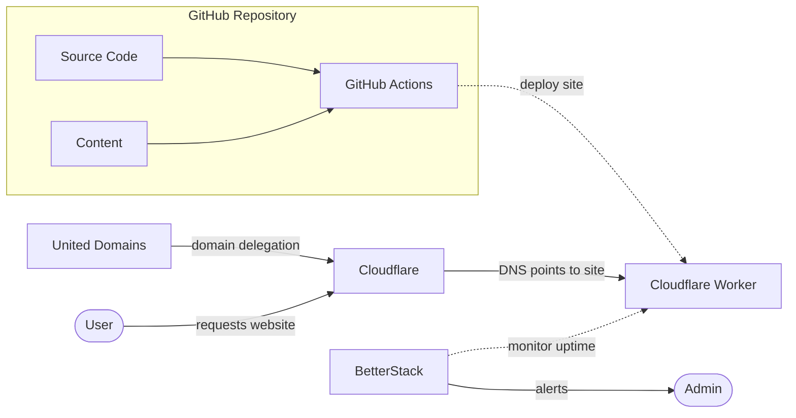

# Garbereder.com

[](https://github.com/ggarbereder/garbereder.com/actions/workflows/static.yml)
[](https://uptime.betterstack.com/?utm_source=status_badge)

## Architecture



## Repository layout

An [npm workspaces](https://docs.npmjs.com/cli/using-npm/workspaces) monorepo: one `npm install`, one `package-lock.json`.

```text
/
├── apps/
│   ├── garbereder.com/   # personal site: Astro, its tests and wrangler.jsonc (Cloudflare Worker garbereder-com)
│   └── start-at-05/      # start-at-05.com: Astro, its tests and wrangler.jsonc (Cloudflare Worker start-at-05)
├── packages/
│   └── config/           # shared tsconfig, ESLint, Prettier, Playwright and html-validate config
├── workers/
│   └── start-at-05-proxy/  # serves start-at-05.com from garbereder.com/start-at-05/
├── scripts/              # security audit, npm env helpers
└── package.json          # workspaces, overrides, allowScripts, lint-staged
```

## Prerequisites

- Node.js (LTS version recommended)
- VS Code (optional)

## Development

Run commands from the repository root. Repo-wide tasks run across all workspaces; app tasks take `-w apps/<name>`.

```bash
npm install                               # all workspaces
npm run dev -w apps/garbereder.com        # dev server on http://localhost:4321
npm run build                             # builds every app into apps/<name>/dist
npm run lint                              # ESLint, Prettier and typecheck for the whole repo
```

### Testing

Tests use [Playwright](https://playwright.dev/) against the production build (`astro preview`), in Chromium, Firefox and WebKit, on desktop, phone and 320px viewports.

```bash
npx playwright install                         # once, downloads the browsers
npm run build -w apps/garbereder.com           # the tests serve dist/
npm run test:html -w apps/garbereder.com       # html-validate on dist/
npm run test:e2e -w apps/garbereder.com        # end-to-end, accessibility, SEO and CSP tests
npm run test:a11y -w apps/garbereder.com       # accessibility tests only
npm run test:visual -w apps/garbereder.com     # visual regression (baselines are per platform)
npm run test                                   # lint, build, html-validate and end-to-end for every app
```

## CI/CD

Github Actions handle continuous integration and deployment:

- Runs on pull requests and main branch, per app: a change under `apps/<name>/` builds, tests and deploys only that app; changes to `packages/`, root config, the lockfile or workflows run every app (`.github/actions/changed-apps`)
- Lints the whole repo once, then builds each app once, validates its HTML and runs its Playwright suite against that build (one job per browser engine, plus visual, in the Playwright image)
- Required checks are `audit`, `build` (every app built and passed html-validate) and `test` (the audit and every app's build, e2e and visual jobs passed); `build` and `test` are gate jobs over the per-app matrix
- Deploys each tested app on main to its own Cloudflare Worker (static assets)
- Every pull request gets a Cloudflare Preview of each app it touches at `https://pr-<number>-<worker>.<subdomain>.workers.dev` (`preview.yml`), linked in one PR comment per app and deleted on merge or close. Each app needs `preview_urls: true` and a `previews` block in its `wrangler.jsonc`; `preview_urls` only takes effect on a production deploy (or in the dashboard). Dependabot PRs get no preview, as they can't read the Cloudflare secrets.

## Security

This project implements several security measures:

- **Dependency Scanning**: Automated vulnerability scanning with `npm audit`
- **Security headers**: strict Content-Security-Policy and related headers in each app's `public/_headers`, verified in every browser engine by its `tests/csp.spec.ts`
- **Code Quality**: ESLint with security-focused rules
- **TypeScript**: Strict type checking to prevent runtime errors
- **Responsible Disclosure**: Security vulnerabilities can be reported via [security.txt](/.well-known/security.txt)

## Accessibility

- **Conformance target**: [WCAG 2.2 Level AA](https://www.w3.org/TR/WCAG22/)
- **Statement**: [Accessibility page](/accessibility/)
- **Automated checks**: axe-core (WCAG 2.2 AA and best practices) and keyboard tests run in CI via Playwright (`npm run test:a11y`)

### Security Scripts

```bash
# Run security audit
npm run security:audit

# Check for outdated dependencies
npm run security:outdated
```
